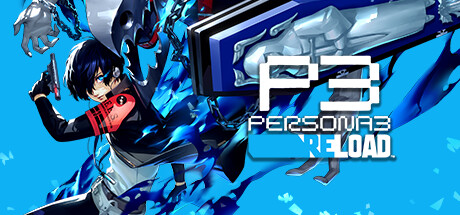

**Persona 3 Reload by Atlus (2024) is the definitive version of the original Persona 3 with rebuilt graphics, new gameplay systems, and the Linked Episodes social content for party members.**

---

## 📖 About

Persona 3 Reload by Atlus (2024) is the definitive version of the original Persona 3 with rebuilt graphics, new gameplay systems, and the Linked Episodes social content for party members. Tartarus' 264 floors and strict calendar management make it the most demanding Persona for completionists.

## ⚠️ Problems Without Trainer

| Problem | Status |
|---------|--------|
| Full Moon Shadow fights outright kill underprepared parties without warning | ✅ Solved |
| Social stat requirements lock Social Links behind grinding academics and courage | ✅ Solved |
| Tartarus fatigue system limits floor progress per night severely | ✅ Solved |
| Rare card fusion materials lock Persona compendium completion behind grinding | ✅ Solved |
| Linked Episode social requirements conflict with main Social Link calendar | ✅ Solved |

## ✅ Solution

The **Persona 3 Reload Trainer** solves all these issues, giving you complete control so you can focus on enjoying the game.

## 🎯 Features

- Unlimited Resources / Currency
- God Mode / Invincibility
- Instant Skill & Ability Cooldown
- One-Hit Kill
- Freeze Timers
- Unlock All Items & Achievements
- Custom Speed Multiplier
- Infinite Stamina / Energy

## 🚀 Quick Start

1. **Disable Windows Defender** temporarily (trainer may trigger false positive)
2. Get the trainer from the button above
3. Launch Persona 3 Reload
4. Run the trainer as Administrator
5. Use the hotkeys to activate cheats in-game

## 💎 Free vs Pro

| Feature | Free | Pro |
|---------|------|-----|
| God Mode | ✅ | ✅ |
| Unlimited Resources | ✅ | ✅ |
| Advanced Cheats | ❌ | ✅ |
| Auto-Updates | ❌ | ✅ |
| Priority Support | ❌ | ✅ |

## 💻 Requirements

- Windows 10 / 11 (64-bit)
- Persona 3 Reload (any version)
- .NET Framework 4.8+
- DirectX 11+

## 🍎 macOS

## ⚖️ Legal

Educational and single-player use only.

---

